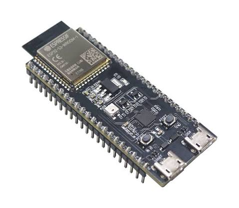
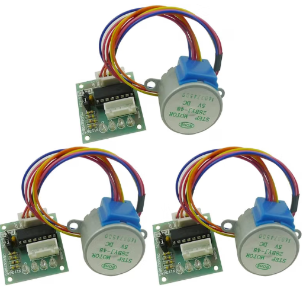
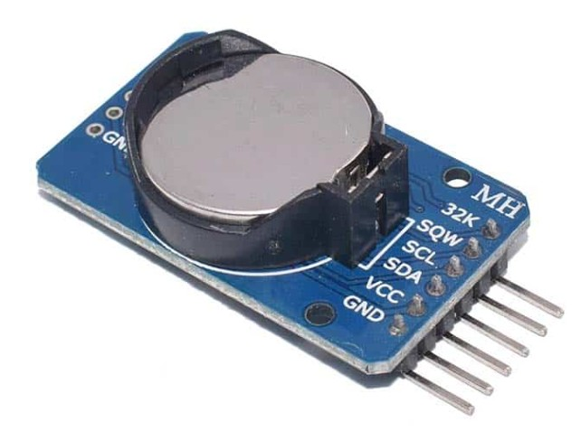

# Wallie - Personal Medicine Dispenser

Project for the course *Embedded Software for the Internet of Things* (University of Trento).

A tabletop dispenser that stores medicines divided by type, sounds an alarm at the intake time, releases the right dose, warns when stock is running low, and is configured through a web-app (schedules and medicines).


**Authors:** Giuseppe Reina, Lorenzo Giovannini, Vittoria Biagetti, Leonardo Aldà

**Name of the device:** Wallie

---

## Table of contents

1. [Build Requirements](#1-build-requirements)
2. [Project layout](#2-project-layout)
3. [Build, burn and run](#3-build-burn-and-run)
4. [User guide](#4-user-guide)
5. [Links](#5-Links)

---

## 1. Build Requirements

### Hardware

1. **ESP32-S3-DevKitC-1 Development Board**

   

   Main board of the project, with WiFi and BLE (ESP-IDF target `esp32s3`).

2. **Three 28BYJ-48 stepper motors with ULN2003 driver boards**

   

   One motor for each cylinder; each rotor advances the inner wheel by one compartment.

3. **DS3231 RTC module (I2C)**

   

   Keeps the correct time even when the WiFi network is not available.

4. **IR break-beam sensor**

   

   Placed under the exit of the cylinders to detect that a pill has fallen into the tray.

5. **Buzzer, status LED and push buttons**

   Intake alarm, status indication and user confirmation.

### Software

The development environment requires:

- [Visual Studio Code](https://code.visualstudio.com/) with the PlatformIO IDE extension for building, flashing, monitoring and debugging from the editor

- A CAD tool ([FreeCAD](https://www.freecad.org/), Fusion 360 or Onshape) and a slicer (PrusaSlicer or Cura), only to modify or print the mechanical parts

---

## 2. Project layout

Planned organisation of the repository (update it to match the final code):

```
wallie-dispenser/
├── CMakeLists.txt
├── sdkconfig.defaults        # default configuration (target, FreeRTOS, partitions)
├── partitions.csv            # partition table (app, NVS, LittleFS for the web-app)
├── README.md
├── main/
│   ├── CMakeLists.txt
│   ├── main.c                # app_main: hardware init and FreeRTOS task creation
│   └── app_config.h          # pin map, timings, task priorities, queue sizes
├── components/
│   ├── scheduler/            # compares the time with the therapies and generates events
│   ├── state_machine/        # intake cycle FSM
│   ├── motor/                # stepper driver driven by a hardware timer
│   ├── sensors/              # buttons and IR barrier: ISRs, debouncing, signal filter
│   ├── rtc_time/             # DS3231 over I2C, NTP, time synchronisation
│   ├── storage/              # NVS / LittleFS persistence of schedules and stock
│   ├── event_log/            # circular buffer with the intake history
│   ├── web_server/           # HTTP server and REST API
│   ├── ui/                   # buzzer, LED, display, PIN
│   └── (optional) scanner/, pump/
├── web/                      # index.html, app.js, style.css (packed into LittleFS)
├── hardware/                 # STL/CAD files, wiring diagram, bill of materials
├── docs/                     # report, diagrams, test plan and results
└── test/                     # tests and test scripts
```

### Firmware architecture

The firmware is organised as FreeRTOS tasks that communicate through queues. Priorities are indicative and are validated during testing.

| Task | Duty | Priority | Communicates via |
|---|---|---|---|
| Motor | Steps the stepper motors and monitors the IR barrier | High | Command queue from the scheduler |
| Scheduler | Checks the time and generates intake events | Medium | Event queues towards UI and motor |
| UI | Buzzer, LED, buttons, display, authentication | Medium | Event queues |
| Network | WiFi, NTP, web server, API | Low | Mutex (with priority inheritance) on shared data |
| Storage | Saves and loads schedules, stock and log | Low | Request queue |

**Intake cycle state machine**

| State | Event | Next state |
|---|---|---|
| IDLE | A therapy time is reached | ALARM |
| ALARM | The user confirms | DISPENSING |
| ALARM | Timeout without confirmation | MISSED (logged), then IDLE |
| DISPENSING | The IR barrier detects the pill | DONE, then IDLE |
| DISPENSING | No pill after N attempts | ERROR (reported), then IDLE |


**REST API**

| Endpoint | Function |
|---|---|
| `GET /api/status` | Current state and next intake |
| `GET`, `POST /api/medicines` | List and edit medicines and stock |
| `GET`, `POST /api/schedules` | List and edit therapies |
| `GET /api/log` | Intake history |
| `POST /api/refill` | Update stock after a refill |

---

## 3. Build, burn and run

### 3.1 Wiring

Wire the components according to the pin map in `main/app_config.h` and the diagram in `hardware/`. The following table must be completed with the final pins:

| Signal | ESP32-S3 GPIO |
|---|---|
| Stepper 1 (IN1-IN4) | TODO |
| Stepper 2 (IN1-IN4) | TODO |
| Stepper 3 (IN1-IN4) | TODO |
| DS3231 SDA / SCL | TODO |
| IR barrier | TODO |
| Confirm button | TODO |
| Buzzer | TODO |
| LED | TODO |

Power rules:

- Power the motors from the external 5 V supply, not from the ESP32 USB port.
- Connect the grounds of the supply and of the ESP32 together.
- If the board resets when a motor starts (brownout), check the supply and the wiring.

### 3.2 Install the toolchain

1. Install ESP-IDF following the official *Get Started* guide of Espressif for your operating system.
2. Open an ESP-IDF terminal, or load the environment in the current shell:
   - Linux / macOS: `. $HOME/esp/esp-idf/export.sh`
   - Windows: use the *ESP-IDF PowerShell* or *ESP-IDF CMD* shortcut created by the installer

### 3.3 Get the code and configure it

```bash
git clone <repository-url>
cd wallie-dispenser
```

In `menuconfig` (or directly in `main/app_config.h`) set:

- WiFi SSID and password
- Time zone and NTP server
- Number of cylinders and steps per compartment

### 3.4 Build

```bash
   //TODO
```

### 3.5 Burn (flash) // dipennde da come lo facciamo

1. Connect the ESP32-S3 to the computer with a USB cable.
2. Find the serial port (for example `/dev/ttyACM0` or `/dev/ttyUSB0` on Linux, `COM3` on Windows).
3. Flash the firmware (bootloader, partition table, application and web-app image):

```bash
   // TODO
```

If flashing does not start, hold the `BOOT` button, press and release `RESET`, then release `BOOT` and retry.

### 3.6 Run and monitor

```bash
   // TODO
```

Exit the monitor with `Ctrl+]`. To build, flash and monitor in one command:

```bash
   //TODO
```

At boot the serial log prints the IP address obtained on the WiFi network. Open `http://<ip-address>/` in a browser to reach the web-app.


## 4. User guide

### 4.1 First start

1. Power on the dispenser with the external 5 V supply and the USB connection.
2. Wait for the device to join the WiFi network and synchronise the time (status LED, TODO: describe the pattern).
3. Open the web-app at the IP address of the device.

### 4.2 Load the medicines

1. Put one pill in each compartment of the inner wheel of a cylinder, one cylinder for each medicine.
2. In the web-app, open **Medicines** and add each medicine with:
   - name
   - cylinder it is loaded in (1 to 3)
   - current stock (number of pills loaded)
   - low-stock threshold
   - whether it needs water (extra, if the water tank is implemented)

### 4.3 Create the schedule

1. Open **Schedules**.
2. Create a therapy by choosing the user (if more than one), the medicine, the time, the weekdays and the dose.
3. Save. The new schedule is active immediately, without a reboot.

### 4.4 Daily use

| Step | What happens |
|---|---|
| 1 | At the scheduled time the buzzer and the LED start the alarm |
| 2 | The user confirms with the button (or after authentication, if enabled) |
| 3 | The rotor advances one compartment and a pill drops into the tray |
| 4 | The IR barrier confirms the drop and the intake is saved in the log |
| 5 | If the water extra is enabled and the medicine needs water, the pump fills the glass |

If the user does not confirm before the timeout, the dose is marked as **missed** in the log.

### 4.5 Low stock and refill

- When the stock of a medicine goes below its threshold, a low-stock alert is shown in the web-app (and on the display, if present).
- To refill, load the pills in the cylinder and press **Refill** in the web-app to update the stock.

### 4.6 History

Open **Log** to see the history of the intakes, with scheduled time, actual time and outcome (taken, missed, error).


## 5. Links

- [Presentation](https://code.visualstudio.com/)

- [Demo Video](https://code.visualstudio.com/)

